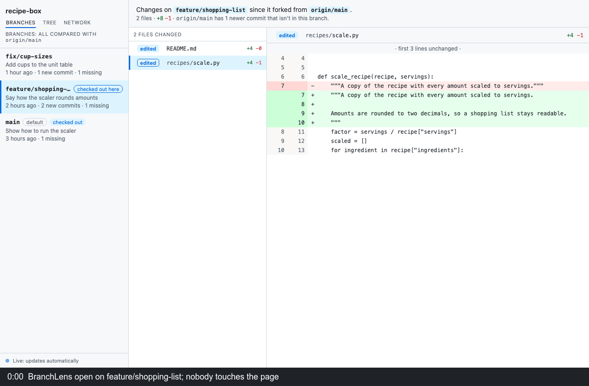

# BranchLens

A vibe coded tool to help you vibe code.

A read-only page that shows what each branch and worktree of a git repository
changes since it forked from `origin/main`, uncommitted and untracked files
included. It refreshes by itself. An optional security check judges a branch
and pushes it when it passes.

Python 3.9+ (standard library only), git 2.31+, macOS or Linux.

## Install

    git clone https://github.com/AndreaCacioppo/branchlens.git
    cd branchlens
    mkdir -p ~/.local/bin
    ln -s "$PWD/branchlens" ~/.local/bin/branchlens   # ~/.local/bin must be on PATH

`pipx install .` or `uv tool install .` also work, without the security check.

## Use

    branchlens [path] [--port N] [--no-browser | --browser] [--check]

Open the printed URL; each start prints a new access code. Branches lists
every branch, with an amber dot on uncommitted edits. Tree draws the last 150
commits. Network shows which files import which (Python, JavaScript,
TypeScript, Java). Ctrl+C stops it.

## Security check and Push

    make -C toolkit install-skills      # once: skills and review workflow into ~/.claude
    branchlens /path/to/repo --check

Needs semgrep and the Claude Code CLI, logged in, as `claude`. Bandit and
pytest are used when present; trivy is needed when a diff changes dependency
files.

Run judges the checked-out, fully committed branch against its base: Semgrep,
Bandit, secrets in every commit, removed security tests, vulnerable
dependencies and the repository's own build and tests, then a Claude review
with one reviewer per checklist entry, a deep dive per changed file and a
verification of each finding. It takes 5 to 15 minutes, costs Claude usage,
sends the diff to Claude and runs the branch's code with your rights: use it
only on repositories you trust.

The base is the one the page shows. By default that is where the branch
forked from `origin/main`, or, for the default branch, its online copy. A
commit picked with "compare from here" in Tree limits the run to the commits
after it; for a commit on another line of history, to the branch's commits
since the two lines meet. "compare from the beginning", at the bottom of Tree, compares with
nothing: every commit and every file counts as new, so a branch that is
already published can be checked whole. Such a run takes longer and also
reports problems older work left behind.

Push turns on only after a confirmed READY TO PUBLISH run on the branch's
current tip, and sends only that commit, without tags or submodules. The run
must have judged every commit the push would send: after a run from a picked
commit, Push stays off while the remote lacks older ones, and a run from the
beginning covers them all. BranchLens never fetches, so what the remote has
is what the last fetch or push saw. `--no-push-host HOST` turns Push off for
a host.

`toolkit/preflight.sh check /path/to/repo [base]` runs the scanners alone,
without Claude (exit 0 passed, 1 failed, 2 inconclusive). Reports go to
`~/preflight-reports/<repo>/`.

## Customize

- Models: `PREFLIGHT_MODEL_MECHANICAL` (default sonnet),
  `PREFLIGHT_MODEL_ANALYSIS` (opus), `PREFLIGHT_MODEL_VERIFY_HIGH` (fable).
- Review entries: add a `## REV-NN — Title` section to
  `toolkit/checks/review/checklist.md`.
- Scanner rules: any `.yaml` in `toolkit/checks/semgrep-rules/`. Semgrep
  registry rules may not be redistributed; name your copy
  `vendored-<name>.yaml` and git ignores it.
- Skills: edit `toolkit/setup/`, then rerun `make -C toolkit install-skills`.
- Exceptions: `toolkit/checks/exceptions.txt`.

## Security

Viewing runs none of the repository's code: git's config-named programs
(diff drivers, filters, hooks, fsmonitor) are off, and BranchLens never
fetches or writes except a Push you click. The server listens on 127.0.0.1.
Anyone with the printed URL has access; the buttons also need a page token
and a matching Origin. READY TO PUBLISH means nothing blocking was found, not
that the code is secure.

Report a vulnerability privately from the Security tab.

## Development

    bash test.sh
    python3 -m pytest toolkit/tests -q

The toolkit tests need pytest, semgrep, bandit, node and the installed skills.

## Licence

MIT, see [LICENSE](LICENSE).
